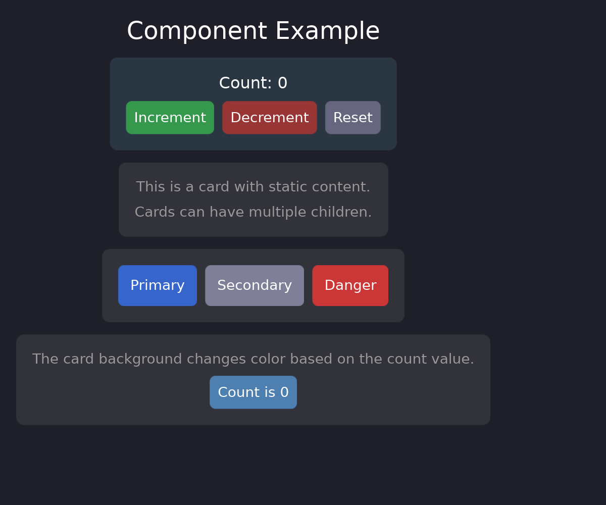

# Creating Components

The `#[component]` macro creates reusable widgets from functions. Function parameters become props, and the function body becomes the render method.



## Basic Component

```rust
# extern crate guido;
use guido::prelude::*;

#[component]
pub fn button(label: String) -> impl Widget {
    container()
        .padding(12.0)
        .background(Color::rgb(0.3, 0.5, 0.8))
        .corners(6.0)
        .when_hovered(|s| s.lighter(0.1))
        .when_pressed(|s| s.ripple())
        .child(container().child(text(label).color(Color::WHITE)))
}
# fn main() {}
```

Use the component with the auto-generated builder:

```rust
# extern crate guido;
# use guido::prelude::*;
# #[component]
# pub fn button(label: String) -> impl Widget {
#     container()
#         .padding(12.0)
#         .background(Color::rgb(0.3, 0.5, 0.8))
#         .corners(6.0)
#         .when_hovered(|s| s.lighter(0.1))
#         .when_pressed(|s| s.ripple())
#         .child(container().child(text(label).color(Color::WHITE)))
# }
# fn main() {
button().label("Click me")
# ;
# }
```

The macro generates a `Button` struct (PascalCase) and a `button()` constructor function from the function name.

## Props

All function parameters are props. Use `#[prop(...)]` attributes for special behavior.

### Standard Props

Parameters without attributes become standard props with `Default::default()`:

```rust
# extern crate guido;
# use guido::prelude::*;
#[component]
pub fn button(label: String) -> impl Widget {
    container().child(text(label))
}
# fn main() {}
```

```rust
# extern crate guido;
# use guido::prelude::*;
# #[component]
# pub fn button(label: String) -> impl Widget {
#     container().child(text(label))
# }
# fn main() {
button().label("Hello")
# ;
# }
```

### Props with Defaults

```rust
# extern crate guido;
# use guido::prelude::*;
#[component]
pub fn button(
    label: String,
    #[prop(default = Color::rgb(0.3, 0.3, 0.4))]
    background: Color,
    #[prop(default = Padding::all(8.0))]
    padding: Padding,
) -> impl Widget {
    container()
        .padding(padding)
        .background(background)
        .child(container().child(text(label).color(Color::WHITE)))
}
# fn main() {}
```

Optional — uses default if not specified:

```rust
# extern crate guido;
# use guido::prelude::*;
# #[component]
# pub fn button(
#     label: String,
#     #[prop(default = Color::rgb(0.3, 0.3, 0.4))]
#     background: Color,
#     #[prop(default = Padding::all(8.0))]
#     padding: Padding,
# ) -> impl Widget {
#     container()
#         .padding(padding)
#         .background(background)
#         .child(container().child(text(label).color(Color::WHITE)))
# }
# fn main() {
button().label("Uses defaults");
button().label("Custom").background(Color::RED).padding(16.0)
# ;
# }
```

### Required Props

A prop the component cannot do without is marked `required`, and becomes an
argument of the constructor rather than a setter — the way `text(content)`
takes its content:

```rust
# extern crate guido;
# use guido::prelude::*;
#[component]
pub fn icon(
    #[prop(required)] source: String,
    #[prop(default = 16.0)] size: f32,
) -> impl Widget {
    container().width(size).height(size).child(text(source))
}
# fn main() {
# let _ =
icon("battery").size(24.0)
# ;
# }
```

Required props are taken in the order they are declared, and each takes what
its setter would have: a value, a closure or a signal — or, for a required
`callback`, a closure or a `Callback`, though not an `Option`, which would let
the caller leave it unset after all. Leaving one out is an ordinary "this function takes 1
argument" error at the call, rather than a component that quietly draws its
`Default`. Every other prop keeps its setter and its default.

A required prop cannot have a `default`, which the caller would never reach,
and a `children` or `slot` prop cannot be required, since both are filled by
methods of their own.

### Callback Props

```rust
# extern crate guido;
# use guido::prelude::*;
#[component]
pub fn button(
    label: String,
    #[prop(callback)] on_click: (),
) -> impl Widget {
    container()
        .on_click(on_click)
        .child(text(label))
}
# fn main() {}
```

Provide closures for events:

```rust
# extern crate guido;
# use guido::prelude::*;
# #[component]
# pub fn button(
#     label: String,
#     #[prop(callback)] on_click: (),
# ) -> impl Widget {
#     container()
#         .on_click(on_click)
#         .child(text(label))
# }
# fn main() {
button()
    .label("Click me")
    .on_click(|| println!("Clicked!"))
# ;
# }
```

Inside the body a callback prop is an `Option<Callback<..>>`, and a required
one is the `Callback` itself. A
[`Callback`](../concepts/reactive-model.md) is a `Copy` handle to the closure,
so it goes into as many closures as needed without being cloned, and is called
with `run`:

```rust
# extern crate guido;
# use guido::prelude::*;
#[component]
pub fn stepper(#[prop(callback)] on_change: fn(i32)) -> impl Widget {
    container()
        .layout(Flex::row().spacing(4))
        // The same handle used twice — no clone in sight
        .child(container().on_click(move || {
            if let Some(cb) = on_change { cb.run(-1) }
        }))
        .child(container().on_click(move || {
            if let Some(cb) = on_change { cb.run(1) }
        }))
}
# fn main() {}
```

A callback builder takes the same three shapes `on_click` does: a closure, a
`Callback`, or an `Option<Callback>`. So a component hands its own prop to the
component it wraps as it reads, and a prop nobody set arrives unset:

```rust
# extern crate guido;
# use guido::prelude::*;
# #[component]
# pub fn stepper(#[prop(callback)] on_change: fn(i32)) -> impl Widget {
#     container()
# }
#[component]
pub fn labelled_stepper(
    label: String,
    #[prop(callback)] on_change: fn(i32),
) -> impl Widget {
    container()
        .layout(Flex::row().spacing(8))
        .child(text(label))
        .child(stepper().on_change(on_change))
}
# fn main() {}
```

A closure's parameter types come from the prop, so `.on_change(|step| ...)`
needs no annotation — unless its body calls a method on `step` before anything
else has said what it is. That one has to name the type, `|step: i32|`,
because the prop's type reaches the closure through a trait rather than an
`Fn` bound.

### Documenting Props

A prop is documented with `///` on its parameter, and the text lands on the
builder method a caller sets it with — on `child` and `children` for the
children prop. The function's own `///` documents the generated struct and its
constructor:

```rust
# extern crate guido;
# use guido::prelude::*;
/// A button with a label on it.
#[component]
pub fn button(
    /// The text on the button.
    label: String,
    /// Called when the button is clicked.
    #[prop(callback)]
    on_click: (),
) -> impl Widget {
    container().on_click(on_click).child(text(label))
}
# fn main() {}
```

Rust refuses a doc comment on an ordinary function's parameter, but
`#[component]` rewrites the function before the compiler looks.

### Render Props

A callback prop with a return type is a render prop: the caller hands the
component a closure that builds part of its page, and the component calls it
with the values it owns. `run` returns what the closure returned:

```rust
# extern crate guido;
# use guido::prelude::*;
#[component]
pub fn picker(
    selected: u32,
    #[prop(callback)] render: fn(u32) -> impl Widget,
) -> impl Widget {
    container()
        .padding(8.0)
        .child(render.map(|render| render.run(selected.get_untracked())))
}
# fn main() {
# let _ =
picker()
    .selected(3u32)
    .render(|index| text(format!("item {index}")))
# ;
# }
```

Declared `-> impl Widget`, the closure may return any widget — a `Container`,
`text`, another component — and the setter boxes it, so inside the body the
prop is an `Option<Callback<(u32,), AnyWidget>>`. Declared with a concrete
type, `-> Container`, the closure has to return that type and the body gets it
back as it is, to style further before placing it. Either kind is forwarded to
another component as a callback prop is, `.render(render)`.

A closure whose branches build different widgets ends each one in
`.into_any()`, and the setter takes it as it is — an `AnyWidget` is a widget
too, and is not boxed a second time:

```rust
# extern crate guido;
# use guido::prelude::*;
# #[component]
# pub fn picker(
#     selected: u32,
#     #[prop(callback)] render: fn(u32) -> impl Widget,
# ) -> impl Widget {
#     container().child(render.map(|render| render.run(selected.get_untracked())))
# }
# fn main() {
# let _ =
picker().render(|index| match index {
    0 => text("none").into_any(),
    _ => container().child(text(format!("item {index}"))).into_any(),
})
# ;
# }
```

A render prop the component cannot draw without is made `required`, and the
body calls it with no `Option` in the way:

```rust
# extern crate guido;
# use guido::prelude::*;
#[component]
pub fn pages(
    #[prop(required)] stack: Vec<String>,
    #[prop(required, callback)] render: fn(String) -> impl Widget,
) -> impl Widget {
    container().child(move || stack.get().last().cloned().map(|page| render.run(page)))
}
# fn main() {
# let _ =
pages(vec!["home".to_string()], |page| text(page))
# ;
# }
```

## Accessing Props

In the function body, each prop is a read-only `Signal<T>` (which is `Copy`). Pass the signal directly to widget methods — this preserves reactivity so props update automatically when the caller provides reactive values (both `RwSignal<T>` and `Signal<T>` work as prop values via `IntoSignal`):

```rust
# extern crate guido;
# use guido::prelude::*;
#[component]
pub fn button(
    label: String,
    #[prop(default = Padding::all(8.0))] padding: Padding,
    #[prop(default = Color::rgb(0.3, 0.3, 0.4))] background: Color,
    #[prop(callback)] on_click: (),
) -> impl Widget {
    container()
        .padding(padding)                  // Pass Signal<Padding> directly (Copy, keeps reactivity)
        .background(background)            // Pass Signal<Color> directly (Copy, keeps reactivity)
        .on_click(on_click)         // Copy handle, no clone
        .child(text(label))
}
# fn main() {}
```

## The Body Runs Once

A component's body executes **one time**, when the widget is first built, inside
its own ownership scope — that is what lets the signals and effects it creates
die with the component. That scope hangs from the one that was current where
the component was made, so its body reads what that scope declared with
`use_context` (see [Scopes](./context.md#scopes)). Reactivity comes from the
closures it leaves behind, not from re-running the body:

```rust
# extern crate guido;
# use guido::prelude::*;
#[component]
pub fn status_chip(label: String, active: bool) -> impl Widget {
    container()
        // Reactive: the closure re-runs when `active` changes
        .background(move || if active.get() { Color::GREEN } else { Color::GRAY })
        // Reactive: the signal is passed through untouched
        .child(text(label))
}
# fn main() {}
```

Reading a prop **outside** a closure takes a snapshot of it, and the component
will never update:

```rust
# extern crate guido;
# use guido::prelude::*;
# fn plain_row() -> Container { container() }
# fn selected_row() -> Container { container() }
# fn main() {
# let active = create_signal(false);
# let _snapshot =
// Wrong: the branch is decided once, for good
if active.get() { selected_row() } else { plain_row() }
# ;

// Right: the choice itself lives in a closure
container().child(move || {
    if active.get() { selected_row().into_any() } else { plain_row().into_any() }
})
# ;
# }
```

Debug builds warn at the exact line when a prop is read this way — unless the
caller passed a plain value, which cannot change anyway. If the snapshot is
deliberate, `get_untracked()` says so and silences the warning.

## Components with Children

```rust
# extern crate guido;
# use guido::prelude::*;
#[component]
pub fn card(
    title: String,
    #[prop(children)] children: (),
) -> impl Widget {
    container()
        .padding(16.0)
        .background(Color::rgb(0.18, 0.18, 0.22))
        .corners(8.0)
        .layout(Flex::column().spacing(8.0))
        .child(container().child(text(title).font_size(18.0).color(Color::WHITE)))
        .children(children)
}
# fn main() {}
```

`children` is the same method the caller uses, and the rows land where the call
is written: the title above stays above them, and anything the component adds
afterwards comes after. A component that never calls it drops what it was
handed.

Use with child/children methods:

```rust
# extern crate guido;
# use guido::prelude::*;
# #[component]
# pub fn card(
#     title: String,
#     #[prop(children)] children: (),
# ) -> impl Widget {
#     container()
#         .padding(16.0)
#         .background(Color::rgb(0.18, 0.18, 0.22))
#         .corners(8.0)
#         .layout(Flex::column().spacing(8.0))
#         .child(container().child(text(title).font_size(18.0).color(Color::WHITE)))
#         .children(children)
# }
# fn main() {
card()
    .title("My Card")
    .child(text("First child"))
    .child(text("Second child"))
# ;
# }
```

## Slot Props

Slots let a component accept named widget positions — useful for layout components
like headers, sidebars, or multi-region containers:

```rust
# extern crate guido;
# use guido::prelude::*;
#[component]
pub fn center_box(
    #[prop(slot)] left: (),
    #[prop(slot)] center: (),
    #[prop(slot)] right: (),
) -> impl Widget {
    container()
        .layout(Flex::row())
        .children(vec![
            left,
            center,
            right,
        ].into_iter().flatten())
}
# fn main() {}
```

Use with the auto-generated builder methods:

```rust
# extern crate guido;
# use guido::prelude::*;
# #[component]
# pub fn center_box(
#     #[prop(slot)] left: (),
#     #[prop(slot)] center: (),
#     #[prop(slot)] right: (),
# ) -> impl Widget {
#     container()
#         .layout(Flex::row())
#         .children(vec![left, center, right].into_iter().flatten())
# }
# fn main() {
center_box()
    .left(text("Left"))
    .center(text("Center"))
    .right(text("Right"))
# ;
# }
```

Each slot accepts any `impl Widget + 'static`. Inside the function body, use the parameter name
directly — it's an `Option<Box<dyn Widget>>` that was automatically consumed from the slot.

## Reactive Props

Props accept signals and closures:

```rust
# extern crate guido;
# use guido::prelude::*;
# #[component]
# pub fn button(
#     label: String,
#     #[prop(default = Color::rgb(0.3, 0.3, 0.4))] background: Color,
# ) -> impl Widget {
#     container().background(background).child(text(label))
# }
# fn main() {
let count = create_signal(0);

button()
    .label(move || format!("Count: {}", count.get()))
    .background(move || {
        if count.get() > 5 {
            Color::rgb(0.3, 0.8, 0.3)
        } else {
            Color::rgb(0.3, 0.5, 0.8)
        }
    })
# ;
# }
```

## Generic Components

A component can be generic over its props' types. The type parameters, their
bounds and the `where` clause carry over to the generated struct and its
constructor, and a prop of type `P` is a `Signal<P>` like any other, so `P`
needs what a signal needs — `Clone` and `'static` — plus `Default` when the prop
has no default of its own:

```rust
# extern crate guido;
# use guido::prelude::*;
#[component]
pub fn labelled<P>(value: P) -> impl Widget
where
    P: Clone + Default + std::fmt::Display + 'static,
{
    container().child(text(move || value.get().to_string()))
}
# fn main() {
# let _ =
container()
    .child(labelled::<u32>().value(42u32))
    .child(labelled::<String>().value("forty-two".to_string()))
# ;
# }
```

Name the type with a turbofish at the call: a prop's setter takes anything that
converts into a signal of `P`, which is too many candidates to infer `P` from.
A generic component with a required prop is named on its struct, because the
constructor carries a generic of its own for each required argument:

```rust
# extern crate guido;
# use guido::prelude::*;
#[component]
pub fn shown<P>(#[prop(required)] value: P) -> impl Widget
where
    P: Clone + std::fmt::Display + 'static,
{
    text(move || value.get().to_string())
}
# fn main() {
# let _ =
Shown::<u32>::new(42u32)
# ;
# }
```

A component cannot take a lifetime parameter, because it is kept as a
`'static` widget.

## Complete Example

```rust,no_run
# extern crate guido;
use guido::prelude::*;

#[component]
pub fn button(
    label: String,
    #[prop(default = Color::rgb(0.3, 0.3, 0.4))] background: Color,
    #[prop(default = Padding::all(8.0))] padding: Padding,
    #[prop(callback)] on_click: (),
) -> impl Widget {
    container()
        .padding(padding)
        .background(background)
        .corners(6.0)
        .when_hovered(|s| s.lighter(0.1))
        .when_pressed(|s| s.ripple())
        .on_click(on_click)
        .child(container().child(text(label).color(Color::WHITE)))
}

#[component]
pub fn card(
    title: String,
    #[prop(default = Color::rgb(0.18, 0.18, 0.22))] background: Color,
    #[prop(children)] children: (),
) -> impl Widget {
    container()
        .padding(16.0)
        .background(background)
        .corners(8.0)
        .layout(Flex::column().spacing(8.0))
        .child(container().child(text(title).font_size(18.0).color(Color::WHITE)))
        .children(children)
}

fn main() {
    App::new().run(|app| {
        let count = create_signal(0);

        let view = container()
            .padding(16.0)
            .layout(Flex::column().spacing(12.0))
            .child(
                card()
                    .title("Counter")
                    .child(container().child(text(move || format!("Count: {}", count.get())).color(Color::WHITE)))
                    .child(
                        container()
                            .layout(Flex::row().spacing(8.0))
                            .child(button().label("Increment").on_click(move || count.update(|c| *c += 1)))
                            .child(button().label("Reset").on_click(move || count.set(0)))
                    )
            );

        app.add_surface(
            SurfaceConfig::new()
                .width(400)
                .height(200)
                .background_color(Color::rgb(0.1, 0.1, 0.15)),
            move || view,
        );
    });
}
```

## When to Use Components

Components are ideal for:

- **Repeated patterns** - Buttons, cards, list items
- **Configurable widgets** - Same structure, different props
- **Encapsulated state** - Self-contained logic
- **Team collaboration** - Clear interfaces and contracts

For one-off layouts, regular functions returning `impl Widget` may be simpler.
