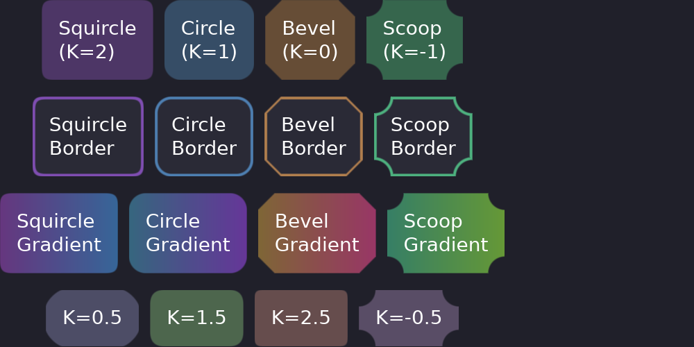

# Borders & Corners

Guido renders crisp, anti-aliased borders using SDF (Signed Distance Field) techniques.



## Basic Border

```rust
# extern crate guido;
# use guido::prelude::*;
# fn main() {
container()
    .border(2.0, Color::WHITE)  // 2px white border
# ;
# }
```

A border is always both halves at once — everywhere. A width with no colour and
a colour with no width are the same thing, which is no border, so there is
nothing for a half-declaration to mean, and no way to write one. Each half takes
a signal of its own, which covers anything that has to change:

```rust
# extern crate guido;
# use guido::prelude::*;
# #[derive(Clone, Copy)]
# struct Theme { text: Color, text_weak: Color, weak: Color, strong: Color, line: Color, accent: Color, error: Color, danger: Color, surface: Color }
# impl Default for Theme { fn default() -> Self { let c = Color::WHITE; Self { text: c, text_weak: c, weak: c, strong: c, line: c, accent: c, error: c, danger: c, surface: c } } }
# fn main() {
# let failed = create_signal(false);
# let theme = Theme::default();
container().border(1.5, move || if failed.get() { theme.danger } else { theme.line })
# ;
# }
```

A border takes room inside the box, as CSS's `box-sizing: border-box` does: the
children are laid out inside the border and the padding, and a scroller's
viewport and extents are measured inside its border. Changing the width, from a
signal, a transition or a state layer, relays the container out and moves what
it holds by the difference.

A state layer says it the same way, and replaces the whole border:

```rust
# extern crate guido;
# use guido::prelude::*;
# #[derive(Clone, Copy)]
# struct Theme { text: Color, text_weak: Color, weak: Color, strong: Color, line: Color, accent: Color, error: Color, danger: Color, surface: Color }
# impl Default for Theme { fn default() -> Self { let c = Color::WHITE; Self { text: c, text_weak: c, weak: c, strong: c, line: c, accent: c, error: c, danger: c, surface: c } } }
# fn main() {
# let theme = Theme::default();
container()
    .border(1.5, theme.line)
    .when_focused(|s| s.border(1.5, theme.accent))
# ;
# }
```

Changing only the colour, as here, moves nothing. A ring that thickens or
appears on focus or hover is an outline instead.

## Outlines

An outline is a ring drawn outside the box — `width` wide, `offset` out from its
edge — above everything the box holds, following its corners: CSS's `outline`.
It takes no room, so showing, hiding or animating one repaints and never relays
anything out. That is what a focus or hover ring wants:

```rust
# extern crate guido;
# use guido::prelude::*;
# #[derive(Clone, Copy)]
# struct Theme { text: Color, text_weak: Color, weak: Color, strong: Color, line: Color, accent: Color, error: Color, danger: Color, surface: Color }
# impl Default for Theme { fn default() -> Self { let c = Color::WHITE; Self { text: c, text_weak: c, weak: c, strong: c, line: c, accent: c, error: c, danger: c, surface: c } } }
# fn main() {
# let theme = Theme::default();
container()
    .corners(8.0)
    .border(1.0, theme.line)
    .outline(2.0, Color::TRANSPARENT.transition(120.0), 2.0)
    .when_focused(|s| s.outline(2.0, theme.accent, 2.0))
# ;
# }
```

The ring fades in from `Color::TRANSPARENT` in the accent's own colour — the
halfway is the accent at half alpha, not a grey (see
[Mixing](colors.md#mixing)).

A rounded corner of the ring is the box's radius grown by `offset + width`, and a
square one stays square. A negative offset draws the ring inside the box, over
its edge. All three halves are declared together, on the container and in a
state layer alike, and each carries its own timing.

The ring is painting outside the box, so it counts in the reach a parent culls
and damages by, as a shadow does; it is cut by the clips above the container,
not by a ripple's.

## Corner Radius

### Uniform Radius

```rust
# extern crate guido;
# use guido::prelude::*;
# fn main() {
container().corners(8.0)  // 8px radius on all corners
# ;
# }
```

## Corner Curvature (Superellipse)

Control the shape of corners using CSS K-values. This determines how the corner curves from the edge to the arc.

### Squircle (K=2)

iOS-style smooth corners. The curve starts further from the corner for a smoother transition.

```rust
# extern crate guido;
# use guido::prelude::*;
# fn main() {
container()
    .corners(Corners::squircle(12.0))
    
# ;
# }
```

### Circle (K=1)

Standard circular corners. This is the default.

```rust
# extern crate guido;
# use guido::prelude::*;
# fn main() {
container()
    .corners(12.0)  // Default is circular
# ;
# }
```

### Bevel (K=0)

Diagonal cut corners. Creates a chamfered look.

```rust
# extern crate guido;
# use guido::prelude::*;
# fn main() {
container()
    .corners(Corners::bevel(12.0))
    
# ;
# }
```

### Scoop (K=-1)

Concave/inward corners. Creates a scooped appearance.

```rust
# extern crate guido;
# use guido::prelude::*;
# fn main() {
container()
    .corners(Corners::scoop(12.0))
    
# ;
# }
```

### Custom Curvature

For values between the presets:

```rust
# extern crate guido;
# use guido::prelude::*;
# fn main() {
container()
    .corners(Corners::superellipse(12.0, 1.5))
      // Between circle and squircle
# ;
# }
```

## Curvature Reference

| Style | K Value | Description |
|-------|---------|-------------|
| Squircle | 2.0 | Smooth, iOS-style |
| Circle | 1.0 | Standard rounded (default) |
| Bevel | 0.0 | Diagonal/chamfered |
| Scoop | -1.0 | Concave inward |

## Animated Borders

A border is declared as a pair and each half carries its own timing, so the
width and the colour can move on curves of their own. A width that moves lays
the container out on every frame, and the content follows it; a hover or press
ring that should leave the content still is an outline, animated the same way:

```rust
# extern crate guido;
# use guido::prelude::*;
# fn main() {
container()
    .border(1.0, Color::rgb(0.3, 0.3, 0.4).transition(150.0))
    .outline(2.0, Color::TRANSPARENT.transition(150.0), 2.0)
    .when_hovered(|s| s
        .border(1.0, Color::rgb(0.5, 0.5, 0.6))
        .outline(2.0, Color::rgb(0.5, 0.5, 0.6), 2.0))
    .when_pressed(|s| s
        .border(1.0, Color::rgb(0.7, 0.7, 0.8))
        .outline(3.0, Color::rgb(0.7, 0.7, 0.8), 2.0))
# ;
# }
```

## Borders with Different Curvatures

Borders respect corner curvature:

```rust
# extern crate guido;
# use guido::prelude::*;
# fn main() {
container()
    .border(2.0, Color::rgb(0.5, 0.3, 0.7))
    .corners(Corners::squircle(12.0))
      // Border follows squircle shape
# ;
# }
```

## Borders with Gradients

Borders work with gradient backgrounds:

```rust
# extern crate guido;
# use guido::prelude::*;
# fn main() {
container()
    .gradient(LinearGradient::horizontal(
        Color::rgb(0.3, 0.1, 0.4),
        Color::rgb(0.1, 0.3, 0.5),
    ))
    .corners(8.0)
    .border(2.0, Color::rgba(1.0, 1.0, 1.0, 0.3))  // Semi-transparent white
# ;
# }
```

## Complete Example

```rust
# extern crate guido;
# use guido::prelude::*;
fn card_with_border() -> Container {
    container()
        .padding(16.0)
        .background(Color::rgb(0.12, 0.12, 0.16))
        .corners(Corners::squircle(12.0))
        
        .border(1.0, Color::rgb(0.2, 0.2, 0.25).transition(150.0))
        .outline(2.0, Color::TRANSPARENT.transition(150.0), 2.0)
        .when_hovered(|s| s
            .border(1.0, Color::rgb(0.4, 0.6, 0.9))
            .outline(2.0, Color::rgb(0.4, 0.6, 0.9), 2.0)
            .lighter(0.03)
        )
        .child(container().child(text("Hover to see the ring").color(Color::WHITE)))
}
# fn main() {}
```
