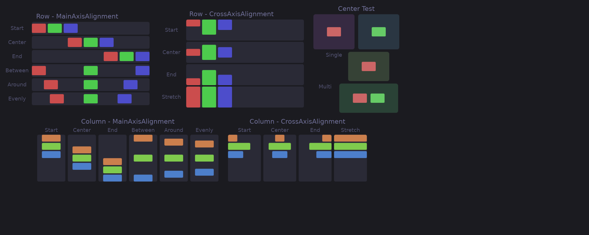

# Layout

Guido uses a flexbox-style layout system for arranging widgets. The `Flex` layout handles rows and columns with spacing and alignment options.



## Basic Layout

### Row (Horizontal)

```rust
# extern crate guido;
# use guido::prelude::*;
# fn main() {
container()
    .layout(Flex::row())
    .children([
        text("Left"),
        text("Center"),
        text("Right"),
    ])
# ;
# }
```

### Column (Vertical)

```rust
# extern crate guido;
# use guido::prelude::*;
# fn main() {
container()
    .layout(Flex::column())
    .children([
        text("Top"),
        text("Middle"),
        text("Bottom"),
    ])
# ;
# }
```

## Spacing

Add space between children:

```rust,ignore
# // not compiled: `[...]` stands in for the children; this block is about
# // the layout above them.
# extern crate guido;
# use guido::prelude::*;
# fn main() {
container()
    .layout(Flex::row().spacing(8.0))
    .children([...])
# ;
# }
```

## Main Axis Alignment

Control distribution along the layout direction:

```rust
# extern crate guido;
# use guido::prelude::*;
# fn main() {
Flex::row().main_alignment(MainAlignment::Center)
# ;
# }
```

### Options

| Alignment | Description |
|-----------|-------------|
| `Start` | Pack at the beginning |
| `Center` | Center in available space |
| `End` | Pack at the end |
| `SpaceBetween` | Equal space between, none at edges |
| `SpaceAround` | Equal space around each item |
| `SpaceEvenly` | Equal space including edges |

The three spacing alignments share out the space the flex is given. Along a
scrolled axis there is no limit and so nothing to share: the children sit
together as with `Start`, and the content is as long as they are.

A child that is hidden, or half a pixel or less along the flex's direction,
keeps no space around it. When no child keeps space, `SpaceAround` and
`SpaceEvenly` centre what they hold, and `SpaceBetween` places what it
holds at the start.

### Visual Examples

```text
Start:        [A][B][C]
Center:          [A][B][C]
End:                      [A][B][C]
SpaceBetween: [A]      [B]      [C]
SpaceAround:   [A]    [B]    [C]
SpaceEvenly:    [A]   [B]   [C]
```

## Cross Axis Alignment

Control alignment perpendicular to the layout direction:

```rust
# extern crate guido;
# use guido::prelude::*;
# fn main() {
Flex::row().cross_alignment(CrossAlignment::Center)
# ;
# }
```

### Options

| Alignment | Description |
|-----------|-------------|
| `Start` | Align to start of cross axis |
| `Center` | Center on cross axis |
| `End` | Align to end of cross axis |
| `Stretch` | Stretch to fill cross axis |
| `Baseline` | Line children up on the baseline of their text |

### Baseline

Text of different sizes in a row does not read as one line when the tops are
aligned — a 24px label and a 12px one float at unrelated heights. `Baseline`
puts them on the line they are written on:

```rust
# extern crate guido;
# use guido::prelude::*;
# fn main() {
container()
    .layout(Flex::row().spacing(8.0).cross_alignment(CrossAlignment::Baseline))
    .children([
        container().child(text("28").font_size(24.0)),
        container().child(text("°C").font_size(12.0)),
    ])
# ;
# }
```

A box reports no baseline of its own, so it is aligned by its bottom edge,
which is what CSS does with it. A container takes the baseline of its
content, so wrapping a text for styling does not lose the alignment. The row
is deep enough for what the alignment moves down: a label pushed down beside
a tall icon keeps its descenders inside the row. In a column there is no
shared line to sit on, and `Baseline` behaves as `Start`.

### Visual Example (Row)

```text
Start:    ┌───┐┌─┐┌──┐
          │ A ││B││ C│
          └───┘│ │└──┘
               └─┘

Center:        ┌─┐
          ┌───┐│B│┌──┐
          │ A │└─┘│ C│
          └───┘   └──┘

End:           ┌─┐
               │B│
          ┌───┐└─┘┌──┐
          │ A │   │ C│
          └───┘   └──┘

Stretch:  ┌───┐┌─┐┌──┐
          │   ││ ││  │
          │ A ││B││ C│
          │   ││ ││  │
          └───┘└─┘└──┘
```

## Centring

`center()` centres the children on both axes. It is shorthand for
`main_alignment(MainAlignment::Center)` together with
`cross_alignment(CrossAlignment::Center)`, and composes with the rest:

```rust
# extern crate guido;
# use guido::prelude::*;
# fn main() {
container()
    .layout(Flex::column().spacing(4.0).center())
    .children([text("Locked"), text("Type your password")])
# ;
# }
```

## Complete Example

```rust
# extern crate guido;
# use guido::prelude::*;
# fn main() {
container()
    .layout(
        Flex::row()
            .spacing(16.0)
            .main_alignment(MainAlignment::SpaceBetween)
            .cross_alignment(CrossAlignment::Center)
    )
    .padding(20.0)
    .children([
        container().child(text("Left").font_size(24.0)),
        container()
            .layout(Flex::column().spacing(4.0))
            .children([
                text("Center"),
                text("Items"),
            ]),
        container().child(text("Right").font_size(24.0)),
    ])
# ;
# }
```

## Nested Layouts

Combine rows and columns for complex layouts:

```rust
# extern crate guido;
# use guido::prelude::*;
# fn main_content() -> Container { container() }
# fn sidebar() -> Container { container() }
# fn main() {
container()
    .layout(Flex::column().spacing(16.0))
    .children([
        // Header row
        container()
            .layout(Flex::row().main_alignment(MainAlignment::SpaceBetween))
            .children([
                text("Logo"),
                text("Menu"),
            ]),
        // Content row
        container()
            .layout(Flex::row().spacing(16.0))
            .children([
                sidebar(),
                main_content(),
            ]),
        // Footer row
        container()
            .layout(Flex::row().main_alignment(MainAlignment::Center))
            .child(text("Footer")),
    ])
# ;
# }
```

## Size Constraints

Control how children size within layouts:

### Fixed Size

```rust
# extern crate guido;
# use guido::prelude::*;
# fn main() {
container()
    .width(200.0)
    .height(100.0)
# ;
# }
```

### Minimum/Maximum

```rust
# extern crate guido;
# use guido::prelude::*;
# fn main() {
container().width(at_least(100.0).at_most(300.0))
# ;
# }
```

### At Least

Request at least a certain size:

```rust
# extern crate guido;
# use guido::prelude::*;
# fn main() {
container()
    .width(at_least(200.0))  // At least 200px, can grow
# ;
# }
```

A minimum is a floor, never a cap, as CSS `min-width` is: content wider than
200 makes the container wider. A child that takes everything it is offered —
a `fill()` child, or a text input — takes everything the container is offered
too, so a field meant to be a set width says so with an exact length, or
bounds it with `at_least(200.0).at_most(400.0)`.

### Fill Available Space

Make a container expand to fill all available space:

```rust
# extern crate guido;
# use guido::prelude::*;
# fn main() {
container()
    .height(fill())  // Fills available height
    .width(fill())   // Fills available width
# ;
# }
```

This is particularly useful for root containers that should fill their surface, or for creating layouts where children are centered within the full available space:

```rust
# extern crate guido;
# use guido::prelude::*;
# fn main() {
container()
    .height(fill())
    .layout(Flex::row().center())
    .child(text("Centered in available space"))
# ;
# }
```

Along a scrolled axis there is no end to fill to, so `fill()` there is the
container's content size. A scroller that should give it the visible area says
so with `Scroll::vertical().fill_viewport(true)` — see the Container chapter.

## Children That Do Not Fit

When a row's children are wider than the row, the children that can be
narrower give the room up, in proportion to their widths — CSS's
`flex-shrink`. None goes below its minimum:

- a container with an exact `width` keeps it, however deep it sits — an icon
  inside a padded button is not squashed by a long title beside the button
- a text that ellipsizes can go down to the `…`, one that wraps to its widest
  word, and one that does neither keeps its whole width
- a container that clips (`Overflow::Hidden`) or scrolls can go down to
  nothing, or to the minimum it declares with `at_least`; any other container
  goes no lower than what it holds, plus its padding

A child held at its minimum leaves the rest of the overflow to the others.
When even the minimums do not fit, the row runs past its end, as it does when
nothing in it can shrink. A row that fits is laid out at its children's natural
sizes, exactly as before. Columns follow the same rule along their height:

```rust
# extern crate guido;
# use guido::prelude::*;
# fn header() -> Container { container().height(30.0) }
# fn rows() -> Container { container() }
# fn main() {
// The list takes what the header leaves, rather than the column's whole height.
container()
    .height(300.0)
    .layout(Flex::column())
    .child(header())
    .child(container().scroll(Scroll::vertical()).child(rows()))
# ;
# }
```

`fill()` children are not part of this: they take what is left once the others
are laid out, and nothing is left when the others overflow.

## Layout Without Explicit Flex

Containers without `.layout()` use `Flex::column()`:

```rust
# extern crate guido;
# use guido::prelude::*;
# fn main() {
// Same as .layout(Flex::column())
container()
    .children([
        text("first"),
        text("second"),
    ])
# ;
# }
```

## Stacking Children (ZStack)

`ZStack` places every child at the same position, stacked along the Z axis —
later children paint on top, and take the pointer first. A layer that draws
where the pointer is — a fill, a border, a blur — or listens there covers what
is beneath it, even a translucent scrim; one that only lays out its content
lets the pointer through:

```rust
# extern crate guido;
# use guido::prelude::*;
# fn main() {
# fn background() -> Container { container() }
# fn content() -> Container { container() }
container()
    .layout(ZStack::new())
    .child(background())
    .child(content())   // drawn on top
# ;
# }
```

### Leaders and Followers

The stack takes the size of its largest child, but a child that declares
`fill()` on an axis **follows** the stack instead of leading it: it never
contributes to that axis and is laid out against the size the other children
established.

That is how a decoration is sized to its sibling without measuring anything:

```rust
# extern crate guido;
# use guido::prelude::*;
# fn card_content() -> Container { container() }
# fn main() {
container()
    .layout(ZStack::new())
    // Follower: exactly as wide and tall as the card below it
    .child(
        container()
            .width(fill())
            .height(fill())
            .background(Color::rgb(0.2, 0.2, 0.3))
    )
    // Leader: the stack is as big as this card
    .child(card_content())
# ;
# }
```

Without this rule the background would expand to all the available space,
and sizing it to its sibling would need a [WidgetRef](../advanced/widget-ref.md)
round-trip — one frame behind, and zero on the first frame.

A hidden child leads nothing, just as it takes no space in a flex: while an overlay
beside a `fill()` background is hidden, the stack is sized as if it were not
there.

The two axes are decided independently, which is what makes the status-bar
case work: a child with only `.height(fill())` fills the bar height and still
leads the width.

```rust
# extern crate guido;
# use guido::prelude::*;
# fn now_playing() -> Container { container() }
# fn visualizer() -> Container { container() }
# fn main() {
container()
    .height(fill())
    .layout(ZStack::new())
    // Follows both axes
    .child(container().width(fill()).height(fill()).child(visualizer()))
    // Fills the bar height, leads the width
    .child(container().height(fill()).child(now_playing()))
# ;
# }
```

When *every* child fills an axis there is no size to follow, and the stack
takes all the space it was offered on that axis — or, along a scrolled axis,
where there is no end to the space, the size of its largest child.

### Positioning Inside the Stack

Every child is placed by an `Alignment`. The stack gives one to all of its
children with `ZStack::new().align(..)`, and a child can declare its own with
`.align_self(..)`, the way CSS's `align-self` overrides `align-items`. The
stack's is the top start until it says otherwise, and a child that says
nothing takes the stack's — so a stack nobody aligns puts every child at its
origin.

```rust
# extern crate guido;
# use guido::prelude::*;
# fn icon_widget() -> Container { container() }
# fn main() {
container()
    .layout(ZStack::new().align(Alignment::CENTER))
    .child(icon_widget())
    // Centred over the icon, as the stack says
    .child(text("3"))
    // Alert dot on the icon's top-right corner, as it says itself
    .child(
        container()
            .width(4)
            .height(4)
            .corners(2)
            .background(Color::RED)
            .align_self(Alignment::TOP_END)
    )
# ;
# }
```

There are nine: `TOP_START`, `TOP_CENTER`, `TOP_END`, `CENTER_START`,
`CENTER`, `CENTER_END`, `BOTTOM_START`, `BOTTOM_CENTER` and `BOTTOM_END`.
Start is the left and the top.

An alignment places a child in the room the stack has left over, so a
follower that fills the stack on an axis has none there and stays put: a
background behind a centred label is still exactly the stack's size. A child
larger than the stack is shared out the same way and overhangs instead —
`CENTER` by the same amount on both sides.

## API Reference

### Flex Builder

```text
Flex::row() -> Flex;                    // Horizontal layout
Flex::column() -> Flex                 // Vertical layout
.spacing(f32) -> Flex                  // Space between children
.main_alignment(MainAlignment) -> Flex
.cross_alignment(CrossAlignment) -> Flex
```

### MainAlignment

```rust
# extern crate guido;
# use guido::prelude::*;
# fn main() {
MainAlignment::Start;
MainAlignment::Center;
MainAlignment::End;
MainAlignment::SpaceBetween;
MainAlignment::SpaceAround;
MainAlignment::SpaceEvenly
# ;
# }
```

### CrossAlignment

```rust
# extern crate guido;
# use guido::prelude::*;
# fn main() {
CrossAlignment::Start;
CrossAlignment::Center;
CrossAlignment::End;
CrossAlignment::Stretch
# ;
# }
```

### Alignment

```rust
# extern crate guido;
# use guido::prelude::*;
# fn main() {
Alignment::TOP_START;
Alignment::TOP_CENTER;
Alignment::TOP_END;
Alignment::CENTER_START;
Alignment::CENTER;
Alignment::CENTER_END;
Alignment::BOTTOM_START;
Alignment::BOTTOM_CENTER;
Alignment::BOTTOM_END
# ;
# }
```

### ZStack

```rust,ignore
# // not compiled: a signature listing — these declarations have no bodies.
# extern crate guido;
# use guido::prelude::*;
# fn main() {
ZStack::new() -> ZStack                // Children stacked, at the top start
.align(Alignment) -> ZStack            // Where every child sits
# ;
# }
```
